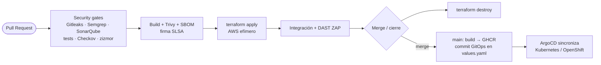

# DevSecOps · GitOps Delivery

[](https://github.com/Danielperdomo29/devsecops-gitops-challenge/actions/workflows/deploy.yaml)
[](https://github.com/Danielperdomo29/devsecops-gitops-challenge/actions/workflows/preview.yaml)
[](https://github.com/Danielperdomo29/devsecops-gitops-challenge/actions/workflows/codeql.yaml)

Prueba técnica DevOps Senior: pipeline de GitHub Actions que construye, escanea y publica una
imagen Docker, la despliega con **Helm + ArgoCD (GitOps)** y crea en **AWS** un entorno efímero
por cada Pull Request, que se destruye al hacer merge o cerrarlo.

**Autor:** Daniel Enrique Perdomo Carvajal · [@Danielperdomo29](https://github.com/Danielperdomo29)

## Demo en vivo

- **Aplicación:** <https://devsecops-gitops-challenge.onrender.com>. Muestra el commit y el
  pipeline que produjeron la instancia.
- **Flujo por Pull Request, en vivo:** <https://devsecops-gitops-challenge.onrender.com/pipeline>

En el plan gratuito de Render, la primera petición puede tardar unos 50 s.

## Entregables

| Requisito | Dónde |
|---|---|
| Workflow de GitHub Actions (push a `main`) | [`.github/workflows/deploy.yaml`](.github/workflows/deploy.yaml) |
| App simple + imagen Docker | [`app/`](app) · [`app/Dockerfile`](app/Dockerfile) |
| Imagen con tag = commit SHA en un registro | `ghcr.io/danielperdomo29/devsecops-api:<sha>` (job `build`) |
| Helm chart para Kubernetes/OpenShift | [`charts/devsecops-api/`](charts/devsecops-api) |
| `values.yaml` con la referencia de la imagen | [`charts/devsecops-api/values.yaml`](charts/devsecops-api/values.yaml) |
| GitOps: el pipeline actualiza `values.yaml` y ArgoCD sincroniza | job `gitops-promote` + verificación `gitops-e2e` (kind + ArgoCD) |
| Manifiesto `Application` de ArgoCD | [`gitops/argocd/application-dev.yaml`](gitops/argocd/application-dev.yaml) |
| **Extra:** entorno efímero en AWS por PR (DevSecOps + FinOps) | [`.github/workflows/preview.yaml`](.github/workflows/preview.yaml) · [`infra/`](infra) |

## Arquitectura



## Ejecutar en local

```bash
cd app && npm ci && npm test && npm start          # http://localhost:8080
docker build app -t devsecops-api:local
docker run --rm -p 8080:8080 --read-only --cap-drop ALL devsecops-api:local
./scripts/security-checks.sh                       # los mismos gates del pipeline
```

## Estructura

```text
app/                  API Node.js 24 (sin dependencias de runtime) + Dockerfile distroless
charts/devsecops-api/ Helm chart endurecido (Kubernetes y OpenShift)
gitops/               ArgoCD (AppProject + Applications) y overrides por entorno
infra/                Terraform: bootstrap de AWS (OIDC, estado, presupuesto) y entorno por PR
.github/              workflows: deploy, preview, gates reutilizables, janitor, CodeQL
scripts/              SonarQube efímero, destroy, gates en local
```
